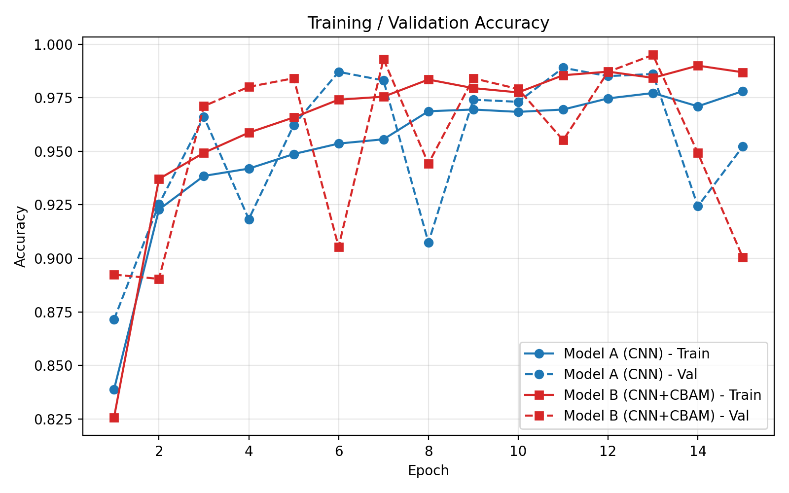
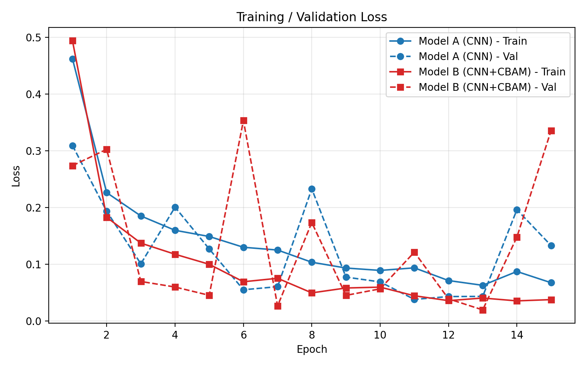

# PlantVillage 五分类：基础 CNN 与 CNN+CBAM 对比实验

本项目使用 PyTorch 在 PlantVillage 数据集上选取 5 个作物叶片类别，比较**基础 CNN** 与**嵌入 CBAM（通道注意力 + 空间注意力）的 CNN**。除注意力模块外，两个模型的数据划分、超参数和随机种子完全一致。

## 实验结果

测试集共 507 张，单次实验结果如下：

| 模型 | 测试准确率 | 宏精确率 | 宏召回率 | 宏 F1 | 参数量 |
|---|---:|---:|---:|---:|---:|
| 基础 CNN | 0.9941 | 0.9942 | 0.9929 | 0.9935 | 390,181 |
| CNN + CBAM | 0.9941 | 0.9944 | 0.9941 | 0.9942 | 401,581 |

- 两个模型在测试集上都只错 3 张。
- CBAM 训练收敛更快、训练 loss 更低，但验证集曲线波动更大。
- 在这个 5 类、约 5000 张图片的任务上，CBAM 没有提升测试准确率，仅略微提升宏召回率和宏 F1。

## 项目结构

```text
.
├── prepare_data.py      # 下载并整理数据集
├── train_compare.py     # 训练、评估、对比与绘图
├── models.py            # 基础 CNN 与 CNN+CBAM
├── cbam.py              # 通道注意力、空间注意力
├── requirements.txt
├── .gitignore
└── outputs/
    ├── accuracy_curves.png
    └── loss_curves.png
```

本仓库不包含数据集和训练权重，运行脚本即可重新生成。

## 环境

- Python 3.8.6（已在 Windows + CPU 环境测试）
- 安装依赖：

```powershell
python -m venv .venv
.venv\Scripts\activate
pip install -r requirements.txt
```

Linux / macOS 激活命令为 `source .venv/bin/activate`。

## 数据准备

```powershell
python prepare_data.py
```

脚本会从 HuggingFace 镜像下载 parquet 原始文件，选取 5 个类别，每类最多 1200 张，按 7:2:1 分层划分，生成：

```text
data/plantvillage_5cls/
├── train/  3512 张
├── val/    1004 张
└── test/    507 张
```

5 个类别：

- Apple_Apple_scab
- Corn_Common_rust
- Potato_Late_blight
- Tomato_Early_blight
- Tomato_healthy

数据来源：[GVJahnavi/PlantVillage_dataset](https://huggingface.co/datasets/GVJahnavi/PlantVillage_dataset)。

脚本默认使用 `https://hf-mirror.com` 镜像，如需官方地址可设置环境变量 `HF_ENDPOINT=https://huggingface.co` 。

> **数据说明**：本仓库仅提供数据下载与整理脚本，不分发数据集图片或 parquet 文件。该数据集在 HuggingFace 页面未明确标注许可证，版权归原作者所有；使用前请自行确认原始 PlantVillage 数据集的授权条款。

## 训练与评估

```powershell
python train_compare.py
```

默认设置：15 epochs，batch size 32，Adam，学习率 1e-3，输入 128×128，随机种子 42，CPU 可运行。

可选参数示例：

```powershell
python train_compare.py --epochs 5
python train_compare.py --batch-size 64 --lr 5e-4
```

运行结束后会在 `outputs/` 生成两个模型的最优权重和曲线图，并在终端打印测试集指标、分类报告和混淆矩阵。

## 结果曲线





## 方法说明

- **基础 CNN**：4 个卷积块（32→64→128→256），每个卷积块为 Conv3×3 + BN + ReLU + MaxPool；之后全局平均池化、Dropout(0.3)、全连接分类。
- **CBAM**：先做通道注意力（平均池化 + 最大池化 → 共享 MLP → Sigmoid），再做空间注意力（通道维平均/最大 → 拼接 → 7×7 卷积 → Sigmoid）。注意力模块插在每个卷积块的卷积之后、池化之前。
- **对照公平性**：两个模型使用相同的数据划分、增强、优化器、学习率和随机种子，唯一差别是 `use_cbam`。

## 结论与局限

1. 在 5 类任务上，两个模型测试准确率均为 0.9941，CBAM 没有带来准确率提升。
2. CBAM 的宏召回率（0.9929→0.9941）和宏 F1（0.9935→0.9942）略有提升。
3. CBAM 训练收敛更快，但验证曲线波动更大，小数据集上存在一定过拟合风险。
4. 本结果为单次实验，测试集只有 507 张，1 张样本约影响 0.2 个百分点，结论应谨慎解读。

## 参考

- Hughes, D. P., & Salathé, M. (2015). An open access repository of images on plant health to enable the development of mobile disease diagnostics. arXiv:1511.08060.
- [PlantVillage dataset on HuggingFace](https://huggingface.co/datasets/GVJahnavi/PlantVillage_dataset)
- Woo, S., Park, J., Lee, J. Y., & Kweon, I. S. (2018). CBAM: Convolutional Block Attention Module. In Proceedings of the European Conference on Computer Vision (ECCV).